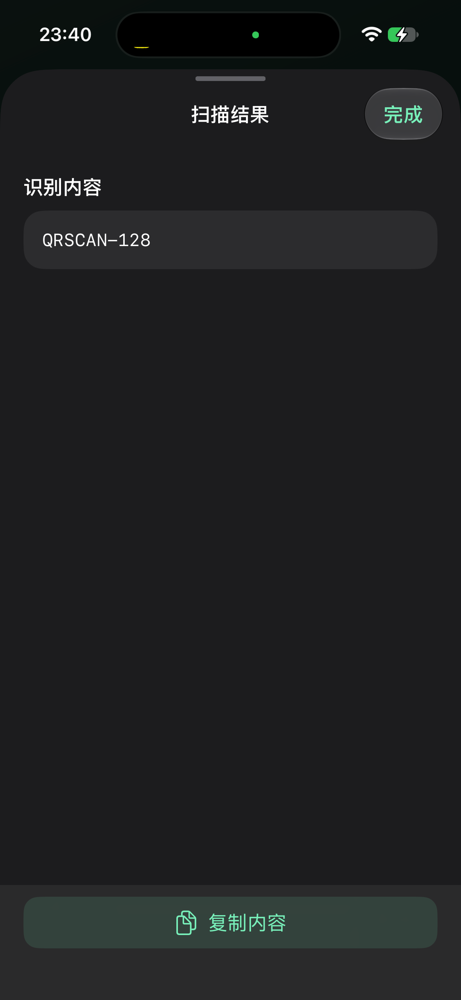
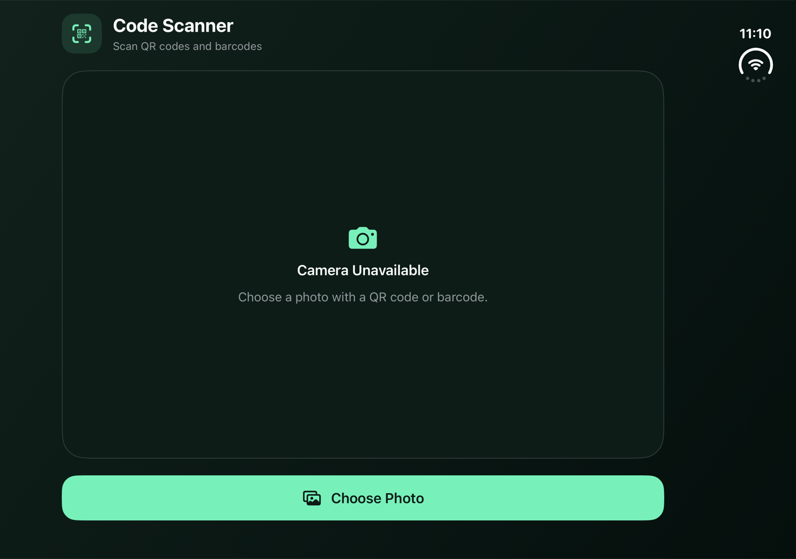

# QRScan

QRScan is an iPhone app for scanning QR codes and barcodes with the camera or from a photo. When a code contains a URL, you can inspect its domain, path, and query parameters, then copy the full link, copy an individual parameter value, or tap **Open Link**.

- A single code in the camera view opens its result automatically. When several codes are visible, tap the arrow beside the one you want.
- Use the flashlight in low light, or choose a saved image from Photos.
- Recognition runs on the device. QRScan requires no account and is available in English and Simplified Chinese.

## Screenshots

| URL details and parameter copying | Barcode result |
| --- | --- |
|  |  |

Version 1.0.1 adapts the layout to the iPhone Duo outer and inner displays. The screenshots below were captured in the iPhone Duo simulator.

| iPhone Duo outer display | iPhone Duo inner display |
| --- | --- |
|  |  |

## Build and test

QRScan requires iOS 17 or later. Open `QRScan.xcodeproj` in Xcode and run the `QRScan` scheme. Use a physical iPhone to test live scanning, or choose a photo in the simulator to test image recognition. Press **⌘U** to run the unit tests.

[GitHub Releases](https://github.com/longbai/qrscan/releases) · [Support](https://longbai.github.io/qrscan/) · [Privacy Policy](https://longbai.github.io/qrscan/privacy.html)
