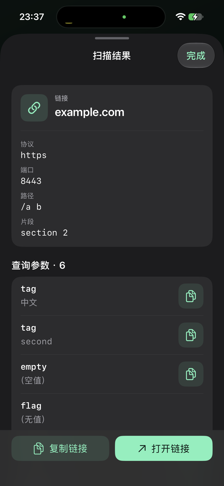
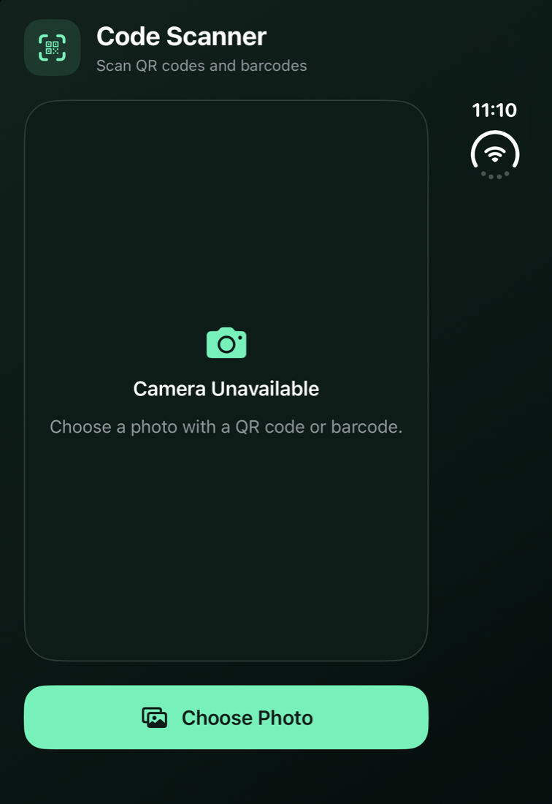

# QRScan

[Download source for 1.0.3](https://github.com/longbai/qrscan/releases/tag/v1.0.3)

QRScan is an iPhone app for scanning QR codes and barcodes and creating QR codes. Scan with the camera or from a screenshot, inspect the destination domain, and copy the full link or an individual query value.

## What’s new in 1.0.3

- **Generate QR codes.** Open the scanner’s more menu to enter or paste text. When the clipboard contains text or a link, use the shortcut on the scanner to generate a code directly.
- **Choose colors and error correction.** Set the foreground and background colors and choose error correction level L, M, Q, or H. The default is M.
- **Save to Photos.** Save the QR code as a PNG or JPEG.

## What’s new in 1.0.2

- **Scan a screenshot from Photos.** Open its share menu and tap **Scan with QRScan** to inspect or copy results.
- **Pick the right code.** Use the camera’s result list or tap a numbered marker on a photo. List entries show the link’s domain or the code format.
- **Copy the exact parameter value.** Switch between decoded and original query parameters. For example, the original view preserves the difference between `a+b` and `a%2Bb`.
- **Keep scanning.** Dismissing a result suppresses repeat pop-ups while the same code stays in view. Retry the camera from the scanner if it fails to start.

Use the flashlight in low light. Scanning and generation run on your device and require no account. The app is available in English, Simplified Chinese, and Japanese.

## Screenshots

| URL details and parameter copying | Barcode result |
| --- | --- |
|  |  |

Version 1.0.1 adapts the layout to the iPhone Duo outer and inner displays. The screenshots below were captured in the iPhone Duo simulator.

| iPhone Duo outer display | iPhone Duo inner display |
| --- | --- |
|  |  |

## Build and test

QRScan requires iOS 17 or later. Open `QRScan.xcodeproj` in Xcode and run the `QRScan` scheme. Use a physical iPhone to test live scanning, or choose a photo in the simulator to test image recognition. Press **⌘U** to run the unit tests.

[GitHub Releases](https://github.com/longbai/qrscan/releases) · [Support](https://longbai.github.io/qrscan/) · [Privacy Policy](https://longbai.github.io/qrscan/privacy.html)
